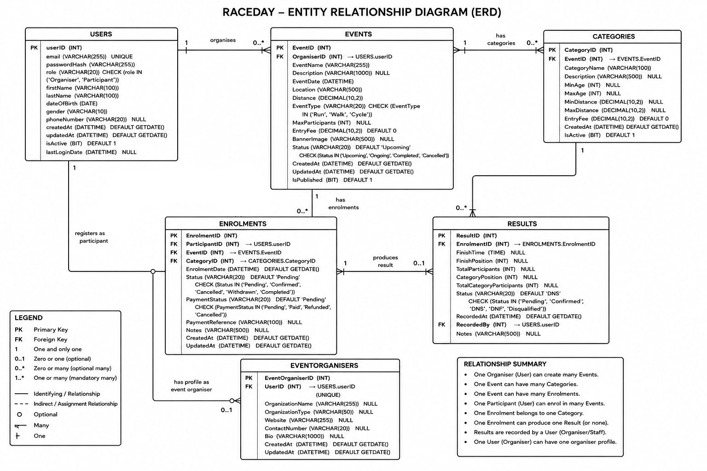
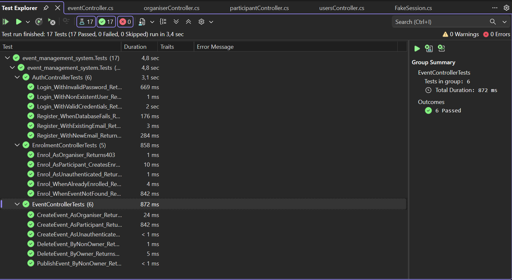
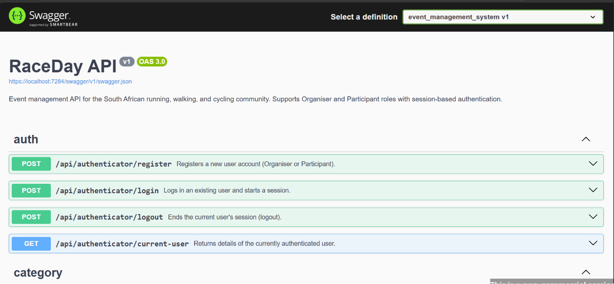
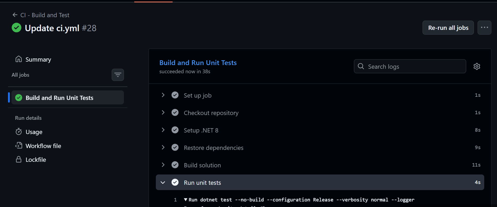

# 🏃 RaceDay - Event Management System

## 📋 Overview

RaceDay is a full-stack web-based event management system designed specifically for the South African road running, walking, and cycling community. The platform allows Event Organisers to create and manage events, categories, and participant results, while Participants can browse upcoming events, enter events, track their personal performance history, and prepare for race day using live weather and route information.

---

## 👥 User Roles

The system supports two distinct user roles:

### 🏢 Organiser

- Create, edit, and delete events
- Manage event categories (age and distance-based)
- View all event enrolments
- Capture and publish participant results
- Upload event banner images
- Dashboard showing event statistics and summaries

### 🏃 Participant

- Create an account and manage profile
- Browse upcoming events with filtering options
- Enter events by selecting a category
- View personal enrolment history
- Track personal race results and performance
- Upload profile picture
- View event details with route information

---

## 📁 Project Structure

```
EventManagementSystem/
├── docs/
│   ├── ERD.png
│   ├── API ENDPOINT PLAN.pdf
│   ├── Raceday_Database.sql
│   ├── tests-passing.png
│   └── ci-build.png
│
├── Controllers/
│   ├── authController.cs
│   ├── usersController.cs
│   ├── eventController.cs
│   ├── categoryController.cs
│   ├── enrolmentController.cs
│   ├── resultController.cs
│   ├── organiserController.cs
│   └── participantController.cs
│
├── Database/
│   ├── Interfaces/
│   │   ├── Iauth_dbconnect.cs
│   │   ├── Iusers_dbconnect.cs
│   │   ├── Ievent_dbconnect.cs
│   │   ├── Icategory_dbconnect.cs
│   │   ├── Ienrolment_dbconnect.cs
│   │   └── Iresult_dbconnect.cs
│   ├── auth_dbconnect.cs
│   ├── users_dbconnect.cs
│   ├── event_dbconnect.cs
│   ├── category_dbconnect.cs
│   ├── enrolment_dbconnect.cs
│   └── result_dbconnect.cs
│
├── Models/
│   ├── Users.cs
│   ├── Events.cs
│   ├── Categories.cs
│   ├── Enrolments.cs
│   ├── Results.cs
│   ├── EventOrganisers.cs
│   └── Enums.cs
│
├── event_management_system.Tests/
│   ├── AuthControllerTests.cs
│   ├── EventControllerTests.cs
│   ├── EnrolmentControllerTests.cs
│   └── FakeSession.cs
│
├── .github/
│   └── workflows/
│       └── ci.yml
│
├── Program.cs
├── appsettings.json
├── event_management_system.csproj
├── event_management_system.slnx
└── README.md
```

---

## 🗄️ Database Schema

The database consists of **6 core tables**:

| Table | Description |
|-------|-------------|
| `users` | Stores all user authentication and profile information |
| `EventOrganisers` | Organiser-specific information linked to users |
| `events` | Core event information including date, location, and type |
| `categories` | Age and distance categories for each event |
| `enrolments` | Links participants to events and categories |
| `results` | Race results for enrolled participants |

### Entity Relationship Diagram



---

## 🔗 API Endpoints

The API exposes **44 endpoints** organised by functionality:

| Category | Endpoints | Description |
|----------|-----------|-------------|
| Authentication | 4 | Register, Login, Logout, Current User |
| User Profile | 5 | View, Update, Profile Picture, Change Password |
| Events | 8 | CRUD operations + Publish |
| Categories | 5 | CRUD operations for event categories |
| Enrolments | 8 | Create, Cancel, View, Statistics |
| Results | 7 | Capture, Update, Delete, View by Event |
| Organiser Dashboard | 4 | Dashboard summary, Events, Stats |
| Participant Dashboard | 3 | Dashboard, Enrolments, Results |
| **Total** | **44** | |

### Full API Documentation

[View Complete API Endpoint Plan](docs/API%20ENDPOINT%20PLAN.pdf)

All endpoints are documented with XML comments and testable through Swagger UI at `/swagger`.

---

## 🧪 Unit Testing

The API includes **17 unit tests** covering authentication, events, and enrolments. All tests use **Moq** to fake the database layer — no SQL Server is needed to run them.

### Test Coverage

| Test Class | Tests | Coverage |
|-----------|-------|----------|
| `AuthControllerTests` | 6 | Register (201, 409, 500) + Login (200, 401, 401) |
| `EventControllerTests` | 6 | Role enforcement + ownership + CRUD |
| `EnrolmentControllerTests` | 5 | Participant enrol + role checks + edge cases |
| **Total** | **17** | |

### Running the Tests Locally

```bash
cd event_management_system.Tests
dotnet test
```

Expected output:

```
Passed!  - Failed:     0, Passed:    17, Skipped:     0, Total:    17
```

### Test Screenshot



---

## 🛠️ Setup Instructions

### Prerequisites

- [.NET SDK 8.0](https://dotnet.microsoft.com/download)
- [SQL Server](https://www.microsoft.com/en-us/sql-server/sql-server-downloads) (2019 or later)
- [SQL Server Management Studio (SSMS)](https://docs.microsoft.com/en-us/sql/ssms/download-sql-server-management-studio-ssms)
- [Git](https://git-scm.com/downloads)

---

### Step 1: Clone the Repository

```bash
git clone https://github.com/xichavomaluleke1/EventManagementSystem.git
cd EventManagementSystem
```

---

### Step 2: Set Up the Database

1. Open **SQL Server Management Studio (SSMS)**
2. Connect to your SQL Server instance (`(localdb)\api_raceday` or your chosen instance)
3. Open `docs/Raceday_Database.sql`
4. Execute the script (press **F5**)
5. Verify the database was created:

```sql
USE raceday_database;
SELECT * FROM users;
SELECT * FROM events;
SELECT * FROM enrolments;
```

**Expected Output:**

- Database `raceday_database` created
- 6 tables created
- Seed data inserted:
  - 4 Users (2 Organisers, 2 Participants)
  - 4 Events
  - 17 Categories
  - 6 Enrolments
  - 2 Results

---

### Step 3: Configure the Connection String

Open `Database/auth_dbconnect.cs` and the other `*_dbconnect.cs` files. Confirm the connection string matches your SQL Server instance:

```csharp
private readonly string connection_string = @"Data source=(localdb)\api_raceday;Database=raceday_database;Trusted_Connection=True;TrustServerCertificate=True;";
```

---

### Step 4: Restore and Run the API

```bash
cd event_management_system
dotnet restore
dotnet build
dotnet run
```

The API will start and Swagger UI will open at `https://localhost:7284/swagger`.

---

### Step 5: Run the Unit Tests

```bash
cd event_management_system.Tests
dotnet test
```

All 17 tests should pass. **No SQL Server required** for the tests.

---

## 📸 Screenshots

### Swagger UI



### Unit Tests Passing


### CI/CD Green Build



---

## 🔄 CI/CD Pipeline

The repository includes a GitHub Actions workflow that runs on every push to `main`:

| Step | Description |
|------|-------------|
| Checkout | Clones the repo |
| Setup .NET 8 | Installs the SDK |
| Restore | Downloads NuGet packages |
| Build | Compiles both projects in Release mode |
| Test | Runs all 17 unit tests |

**No database is required in CI** because tests use Moq to fake the data layer.

The workflow file is at `.github/workflows/ci.yml`.

---

## 📹 Video Presentation

### Part 1 - System Planning & Database Design

Walkthrough of the ERD, API endpoint plan, and SQL script demonstrated live in SSMS.

[Part 1 Video](https://youtu.be/GcvcQzto8Z4)

---

### Part 2 - API Implementation & Testing

[Part 2 Video](https://youtu.be/h_wIFnYOs64)
---

## 📝 Part 1 Submission Checklist

- [x] GitHub repository created
- [x] `/docs` folder created
- [x] ERD diagram saved as `ERD.png`
- [x] API endpoint plan saved as `API ENDPOINT PLAN.pdf`
- [x] SQL script saved as `Raceday_Database.sql`
- [x] README.md with setup instructions
- [x] 20+ meaningful commits made
- [x] CI/CD workflow configured
- [x] CI/CD green build screenshot included
- [x] YouTube video link included

---

## 📝 Part 2 Submission Checklist

- [x] ASP.NET Core Web API project created
- [x] ADO.NET database access (as taught in class)
- [x] All 44 endpoints from Part 1 plan implemented
- [x] Session-based authentication implemented
- [x] Role-based access control enforced (Organiser vs Participant)
- [x] Passwords hashed with BCrypt
- [x] XML documentation added to all controllers
- [x] Swagger integration with descriptions and response codes
- [x] 17 unit tests with xUnit + Moq
- [x] Database layer separated into interfaces for testability
- [x] CI/CD workflow updated to run tests
- [x] Green build screenshot included
- [x] README with setup instructions
- [x] YouTube video link included

---

## 📊 Technologies Used

| Technology | Purpose |
|------------|---------|
| **SQL Server** | Database management |
| **ADO.NET** | Database access layer |
| **ASP.NET Core Web API** | Backend REST API |
| **BCrypt.Net-Next** | Password hashing |
| **Swashbuckle.AspNetCore** | Swagger / OpenAPI docs |
| **xUnit** | Unit test framework |
| **Moq** | Mocking framework for tests |
| **GitHub Actions** | CI/CD automation |

---

## 👨‍💻 Author

**Name:** Xichavo Maluleke  
**GitHub:** [xichavomaluleke1](https://github.com/xichavomaluleke1)  
**Repository:** [EventManagementSystem](https://github.com/xichavomaluleke1/EventManagementSystem.git)

---

## 📄 License

This project is for educational purposes as part of the Portfolio of Evidence (POE) assessment.

---

**© 2026 RaceDay - All Rights Reserved**
