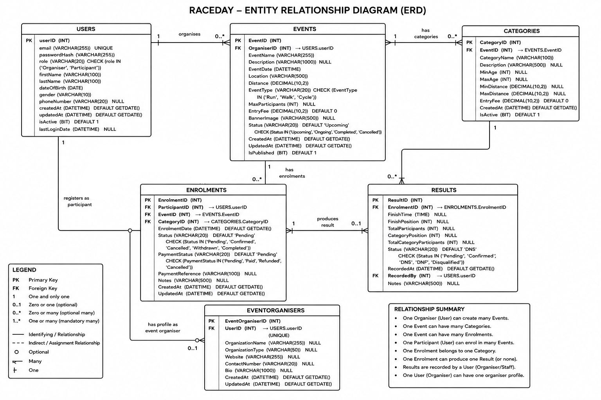
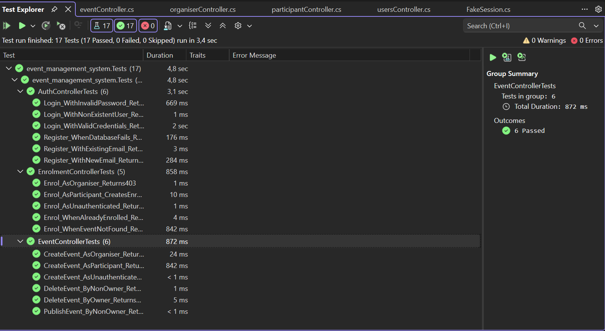
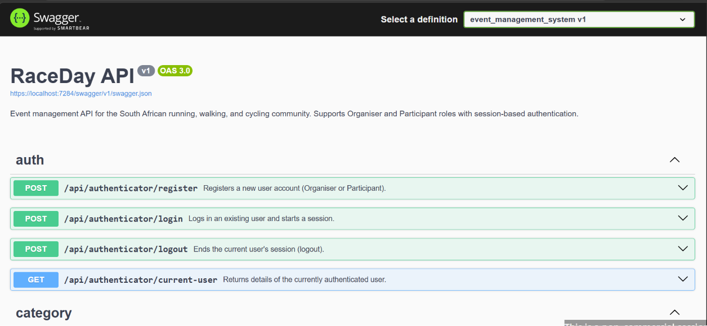
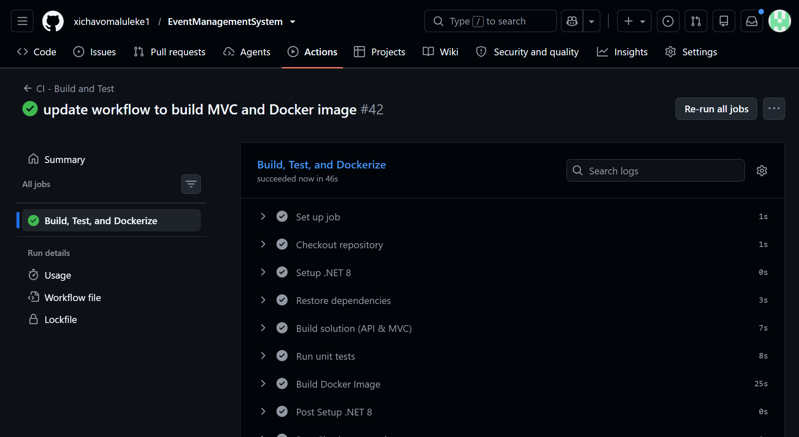

# 🏃 RaceDay - Event Management System


## 📋 Overview

RaceDay is a full-stack, cloud-aware web-based event management system designed specifically for the South African road running, walking, and cycling community. 

The platform is divided into three parts:
1. **Part 1:** System planning (ERD, API Endpoint Plan, SQL Database Script).
2. **Part 2:** ASP.NET Core Web API with session authentication and unit testing.
3. **Part 3:** ASP.NET Core MVC Web Application, Azure Blob Storage integration, and Docker containerization.

---

## 👥 User Roles

The system supports two distinct user roles with strict role-based access control:

### 🏢 Organiser
- Create, edit, and delete events.
- Manage event categories (age and distance-based).
- View all event enrolments and update payment statuses.
- Capture and publish participant results.
- Upload event banner images to Azure Blob Storage.
- Dashboard showing event statistics and summaries.

### 🏃 Participant
- Create an account and manage their profile.
- Browse upcoming events with filtering options.
- Enter events by selecting a category.
- View personal enrolment history.
- Track personal race results and performance.
- Upload profile pictures to Azure Blob Storage.

---

## 🏗️ Architecture

The application follows a clean 3-tier architecture:
1. **Frontend:** ASP.NET Core MVC (`RaceDayMVC`)
2. **Backend API:** ASP.NET Core Web API (`event_management_system`)
3. **Database:** SQL Server via ADO.NET
4. **Cloud Storage:** Azure Blob Storage for image handling

*Note: The MVC application uses `HttpClient` to communicate with the API. It does not have direct access to the database or Azure.*

---

## 📁 Project Structure

```text
EventManagementSystem/
│
├── docs/
│   ├── ERD.png
│   ├── API ENDPOINT PLAN.pdf
│   ├── Raceday_Database.sql
│   ├── tests-passing.png
│   └── ci-build.png
│
├── event_management_system/              # Part 2: The API
│   ├── Controllers/
│   ├── Database/
│   │   ├── Interfaces/
│   │   └── *_dbconnect.cs
│   ├── Models/
│   ├── Services/                         # Azure Blob Service
│   └── Program.cs
│
├── event_management_system.Tests/        # Part 2: Unit Tests
│   ├── AuthControllerTests.cs
│   ├── EventControllerTests.cs
│   ├── EnrolmentControllerTests.cs
│   └── FakeSession.cs
│
├── RaceDayMVC/                           # Part 3: The Frontend
│   ├── Controllers/
│   │   ├── AuthController.cs
│   │   ├── HomeController.cs
│   │   ├── OrganiserController.cs
│   │   ├── ParticipantController.cs
│   │   └── ProfileController.cs
│   ├── Models/
│   │   ├── CategoryFormViewModel.cs
│   │   ├── CreateEventViewModel.cs
│   │   ├── ErrorViewModel.cs
│   │   ├── EventEnrolmentsViewModel.cs
│   │   ├── EventViewModel.cs
│   │   ├── LoginViewModel.cs
│   │   ├── MyEventViewModel.cs
│   │   ├── MyResultViewModel.cs
│   │   ├── ProfileViewModel.cs
│   │   ├── RegisterViewModel.cs
│   │   └── ResultEntryViewModel.cs
│   ├── Services/
│   │   ├── ApiService.cs
│   │   └── IApiService.cs
│   ├── Views/
│   │   ├── Auth/
│   │   ├── Home/
│   │   ├── Organiser/
│   │   ├── Participant/
│   │   ├── Profile/
│   │   └── Shared/
│   ├── wwwroot/
│   │   ├── css/
│   │   ├── images/
│   │   ├── js/
│   │   └── lib/
│   ├── appsettings.json
│   ├── Dockerfile                        # Docker configuration
│   └── Program.cs
│
├── .github/
│   └── workflows/
│       └── ci.yml
│
└── README.md
```

---

## 🗄️ Database Schema

The database consists of **6 core tables**:

| Table | Description |
|-------|-------------|
| `users` | Stores all user authentication and profile information |
| `EventOrganisers` | Organiser-specific information linked to users |
| `events` | Core event information including date, location, and type |
| `categories` | Age and distance categories for each event |
| `enrolments` | Links participants to events and categories |
| `results` | Race results for enrolled participants |

### Entity Relationship Diagram



---

## 🔗 API Endpoints

The API exposes **44 endpoints** organised by functionality:

| Category | Endpoints | Description |
|----------|-----------|-------------|
| Authentication | 4 | Register, Login, Logout, Current User |
| User Profile | 5 | View, Update, Profile Picture, Change Password |
| Events | 8 | CRUD operations + Publish |
| Categories | 5 | CRUD operations for event categories |
| Enrolments | 8 | Create, Cancel, View, Statistics |
| Results | 7 | Capture, Update, Delete, View by Event |
| Organiser Dashboard | 4 | Dashboard summary, Events, Stats |
| Participant Dashboard | 3 | Dashboard, Enrolments, Results |
| **Total** | **44** | |

### Full API Documentation

[View Complete API Endpoint Plan](docs/API%20ENDPOINT%20PLAN.pdf)

All endpoints are documented with XML comments and testable through Swagger UI at `/swagger`.

---

## ☁️ Azure Blob Storage Integration

In Part 3, Azure Blob Storage was integrated into the API to support image uploads. 
* **Event Banners:** Organisers can upload banner images via the MVC app, which are sent to the API and stored in Azure.
* **Profile Pictures:** Participants can upload profile pictures following the same process.
* **Security:** The MVC application never communicates directly with Azure; all file handling goes through the API. Connection strings are kept secure in `appsettings.Development.json` and excluded from Git.

---

## 🧪 Unit Testing

The API includes **17 unit tests** covering authentication, events, and enrolments. All tests use **Moq** to fake the database layer — no SQL Server is needed to run them.

### Test Coverage

| Test Class | Tests | Coverage |
|-----------|-------|----------|
| `AuthControllerTests` | 6 | Register (201, 409, 500) + Login (200, 401, 401) |
| `EventControllerTests` | 6 | Role enforcement + ownership + CRUD |
| `EnrolmentControllerTests` | 5 | Participant enrol + role checks + edge cases |
| **Total** | **17** | |

### Running the Tests Locally

```bash
cd event_management_system.Tests
dotnet test
```

Expected output:

```text
Passed!  - Failed:     0, Passed:    17, Skipped:     0, Total:    17
```

### Test Screenshot



---

## 🛠️ Setup Instructions

### Prerequisites

- [.NET SDK 8.0](https://dotnet.microsoft.com/download)
- [SQL Server](https://www.microsoft.com/en-us/sql-server/sql-server-downloads) (2019 or later)
- [SQL Server Management Studio (SSMS)](https://docs.microsoft.com/en-us/sql/ssms/download-sql-server-management-studio-ssms)
- [Git](https://git-scm.com/downloads)
- [Docker Desktop](https://www.docker.com/products/docker-desktop/) (For Part 3)
- An active Azure Account (For Blob Storage)

---

### Step 1: Clone the Repository

```bash
git clone https://github.com/xichavomaluleke1/EventManagementSystem.git
cd EventManagementSystem
```

---

### Step 2: Set Up the Database

1. Open **SQL Server Management Studio (SSMS)**
2. Connect to your SQL Server instance (`(localdb)\api_raceday` or your chosen instance)
3. Open `docs/Raceday_Database.sql`
4. Execute the script (press **F5**)
5. Verify the database was created:

```sql
USE raceday_database;
SELECT * FROM users;
SELECT * FROM events;
SELECT * FROM enrolments;
```

**Expected Output:**
- Database `raceday_database` created
- 6 tables created
- Seed data inserted (4 Users, 4 Events, 17 Categories, 6 Enrolments, 2 Results)

---

### Step 3: Configure the API (Azure & Database)

1. Open `event_management_system/appsettings.Development.json`.
2. Ensure your SQL Server connection string is correct in the `*_dbconnect.cs` files.
3. Add your Azure Storage Connection String to `appsettings.Development.json`:

```json
{
  "AzureStorage": {
    "ConnectionString": "YOUR_AZURE_CONNECTION_STRING_HERE",
    "ContainerName": "raceday-images"
  }
}
```

---

### Step 4: Restore and Run the API

```bash
cd event_management_system
dotnet restore
dotnet build
dotnet run
```

The API will start and Swagger UI will open at `https://localhost:7284/swagger`.

---

### Step 5: Run the MVC Application

Open a **second** terminal in the root folder:

```bash
cd RaceDayMVC
dotnet run
```

The web app will start on a new port (e.g., `https://localhost:7039`).

---

### Step 6: Docker Setup (Part 3)

The MVC application is fully containerised. 
1. Ensure Docker Desktop is running.
2. Ensure the API is running locally.
3. Build the Docker image from the root folder:
```bash
docker build -t raceday-mvc -f RaceDayMVC/Dockerfile .
```
4. Run the container:
```bash
docker run -d -p 8080:8080 --name raceday-app -e API_BASE_URL="https://host.docker.internal:7284/" raceday-mvc
```
5. Access the app at `http://localhost:8080`.

---

## 📸 Screenshots

### Swagger UI



### Unit Tests Passing


### CI/CD Green Build



---

## 🔄 CI/CD Pipeline

The repository includes a GitHub Actions workflow that runs on every push to `main`:

| Step | Description |
|------|-------------|
| Checkout | Clones the repo |
| Setup .NET 8 | Installs the SDK |
| Restore | Downloads NuGet packages |
| Build | Compiles both API and MVC projects in Release mode |
| Test | Runs all 17 unit tests |

**No database is required in CI** because tests use Moq to fake the data layer.

The workflow file is at `.github/workflows/ci.yml`.

---

## 📹 Video Presentation

### Part 1 - System Planning & Database Design

Walkthrough of the ERD, API endpoint plan, and SQL script demonstrated live in SSMS.

[Part 1 Video](https://youtu.be/GcvcQzto8Z4)

---

### Part 2 - API Implementation & Testing

[Part 2 Video](https://youtu.be/h_wIFnYOs64)

---

### Part 3 - MVC, Blob Storage & Docker

[Part 3 Video](https://youtu.be/YOUR_PART_3_VIDEO_LINK_HERE)

---

## 📝 Part 1 Submission Checklist

- [x] GitHub repository created
- [x] `/docs` folder created
- [x] ERD diagram saved as `ERD.png`
- [x] API endpoint plan saved as `API ENDPOINT PLAN.pdf`
- [x] SQL script saved as `Raceday_Database.sql`
- [x] README.md with setup instructions
- [x] 20+ meaningful commits made
- [x] CI/CD workflow configured
- [x] CI/CD green build screenshot included
- [x] YouTube video link included

---

## 📝 Part 2 Submission Checklist

- [x] ASP.NET Core Web API project created
- [x] ADO.NET database access (as taught in class)
- [x] All 44 endpoints from Part 1 plan implemented
- [x] Session-based authentication implemented
- [x] Role-based access control enforced (Organiser vs Participant)
- [x] Passwords hashed with BCrypt
- [x] XML documentation added to all controllers
- [x] Swagger integration with descriptions and response codes
- [x] 17 unit tests with xUnit + Moq
- [x] Database layer separated into interfaces for testability
- [x] CI/CD workflow updated to run tests
- [x] Green build screenshot included
- [x] README with setup instructions
- [x] YouTube video link included

---

## 📝 Part 3 Submission Checklist

- [x] ASP.NET Core MVC project created
- [x] Consumes the Part 2 API (no direct DB access)
- [x] Session-based authentication and role-based navigation
- [x] Organiser Interface (Dashboard, Events, Categories, Enrolments, Results)
- [x] Participant Interface (Home, Event Details, My Events, My Results, Profile)
- [x] Azure Blob Storage integrated via the API
- [x] UI Design matches RaceDay brand
- [x] Dockerfile created and tested
- [x] CI/CD workflow updated to build MVC project
- [x] YouTube video link included

---

## 📊 Technologies Used

| Technology | Purpose |
|------------|---------|
| **SQL Server** | Database management |
| **ADO.NET** | Database access layer |
| **ASP.NET Core Web API** | Backend REST API |
| **ASP.NET Core MVC** | Frontend web application |
| **Azure Blob Storage** | Cloud storage for images |
| **BCrypt.Net-Next** | Password hashing |
| **Swashbuckle.AspNetCore** | Swagger / OpenAPI docs |
| **xUnit** | Unit test framework |
| **Moq** | Mocking framework for tests |
| **Docker** | Containerization |
| **GitHub Actions** | CI/CD automation |
| **Bootstrap 5** | Responsive UI framework |

---

## 👨‍💻 Author

**Name:** Xichavo Maluleke  
**GitHub:** [xichavomaluleke1](https://github.com/xichavomaluleke1)  
**Repository:** [EventManagementSystem](https://github.com/xichavomaluleke1/EventManagementSystem.git)

---

## 📄 License

This project is for educational purposes as part of the Portfolio of Evidence (POE) assessment.

---

**© 2026 RaceDay - All Rights Reserved**